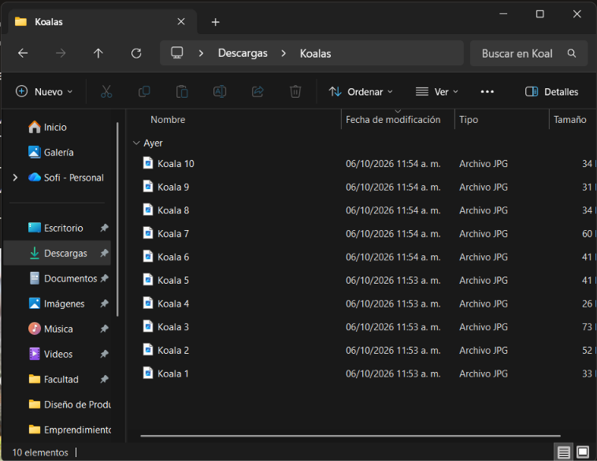
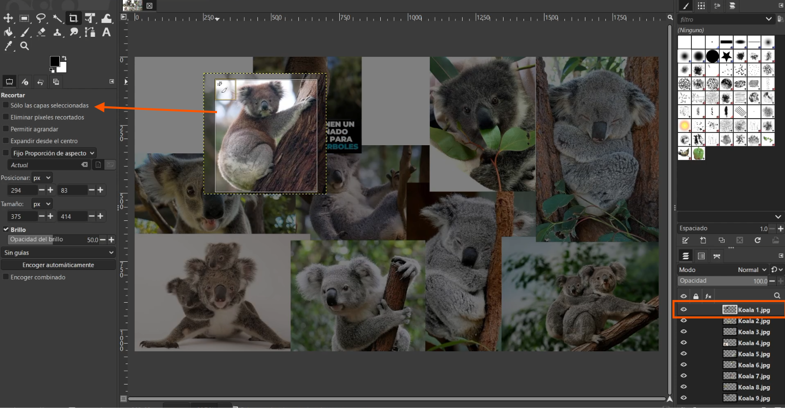

# Edición de fotografía

GIMP es un software de edición de imágenes, bastante parecido a Illustrator pero más sencillo, considero que es una mezcla de Illus con Photoshop.



## Luego de descargar ¿Qué?

Para este ejercicio no me enfoqué en lo estético sino en explorar las herramientas disponibles en GIMP y ¿con qué otra cosa que no fueran Koalas?

Para empezar seleccioné y descargué las imágenes que iba a utilizar.

<figure><figcaption>
Archivos descargados en una sola carpeta
</figcaption></figure>

Luego inciamos un nuevo archivo en GIMP

<figure><figcaption>
En archivos, le damos a nuevo y nos abrirá una nueva ventana.
</figcaption></figure>

<figure><figcaption>
Aparecerá esta ventana y le damos a aceptar
</figcaption></figure>

Al crear esta "imagen nueva" podremos _tirar_ ahí todas las fotos que descargamos.

<figure><figcaption>
Simplemente seleccionalas desde la carpeta de archivos y las sueltas en la "imagen" de GIMP
</figcaption></figure>

Y ahora nada más queda ubicarlas y recortarlas a tu gusto, pero ¿cómo? Bueno, así...

### ¿Cómo mover las imágenes?

Selecciona la capa de la imagen que quieres mover y luego haz clic en la herramienta que está en circulo en la figura de abajo. Con esa herramienta solo podrás mover las imágenes, no cambiar su tamaño, eso te mostraré más adelante.

<figure><figcaption>
La capa señalada con un rectángulo y la herramienta encerrada en un círculo.
</figcaption></figure>

### ¿Cómo cortar imágenes?

Para recortar seleccionas la herramienta que está seleccionada en la siguiente imagen y NO TE OLVIDES de seleccionar la opción de "Solo la capa seleccionada"

<figure><figcaption>
Activar opción "Solo las capas seleccionadas"
</figcaption></figure>

NO TE OLVIDES de seleccionar la opción de "Solo la capa seleccionada" o te pasará esto.

<figure><figcaption>
Sí me pasó en la vida real, pero dale ctrl+z y seguí con tu vida.
</figcaption></figure>

### ¿Qué otras cosas puedo hacer?

Cuando ordenes y corte todas las fotos a tu gusto. En mi caso, combiné en una sola capa todas las imágenes (haz esto solo si estás seguro de tu composición) luego, le puse un filtro de "distorsión de lente", usé la herramienta de texto, le agregué "stickers" con la herramienta de pinceles y por último usé la herramienta de transformación de deformación. Te muestro en la siguiente imagen cómo acceder a estas herramientas

<figure><figcaption>
(1) Combinar capas. (2) Distorsión de lente. (3) Herramienta de pinceles. (4) Herramienta de texto. (5) Transformación de deformación.
</figcaption></figure>

Y luego de todo esto, este fue el resultado final.

<figure><figcaption>
Ejemplo para experimentar herramientas de GIMP
</figcaption></figure>

## Preguntas, problemas y soluciones

¿Cómo cambio el tamaño de mis imágenes?

En otros softwares solo con la herramienta de mover se puede modifiar el tamaño de estas imágenes, en el caso de GIMP debes usar esta herramienta llamada "transformación unificada".

<figure><figcaption></figcaption></figure>

¿Qué tanto puedo hacer en GIMP?

En mi opinión hay mejores opciones, pero teniendo en cuenta que esta es una gratuita se pueden hacer varias cosas, pero no tienen un acabado profesional ni muchas opciones de edición como otras versiones. Si buscas un software que te salva, puedes utilizar este, pero si buscas uno que te resuelva varios problemas personalmente iría con otras opciones pagas como Illustrator o Photoshop

***


¡Ve la siguiente documentación dando click a la flecha de la derecha!

