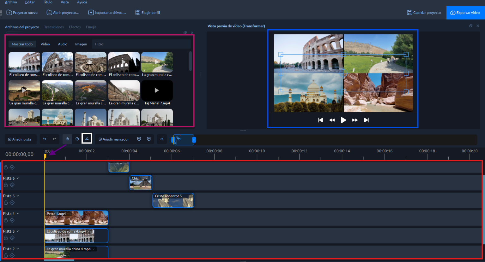
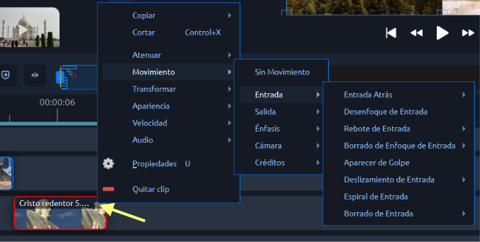
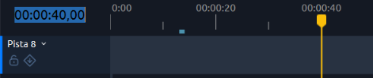

# Editando el video

OpenShot es un software para edición de videos gratuito y bastante completo. Ahora veremos como utilizarlo.



## ¿Cómo empiezo a editar?

Primeramente debemos tener todos los videos que utilizaremos en una misma carpeta para mejor organización.

Luego abrimos OpenShot donde esta será nuestra pantalla de inicio.

<figure><figcaption>
En la ventana "elegir perfil" podrás cambiar el tamaño y resolución del video
</figcaption></figure>

En este caso, usaré el formato horizontal por lo que no debo cambiar nada, pero en caso de quererlo en vertical puedes poner la opción "FHD Vertical" con la resolución que prefieras.

### ¿Dónde cargo mis videos y fotos?

Luego, _tira_ tus videos o fotos en el cuadro vacío de esta manera.

<figure><figcaption></figcaption></figure>

## ¿Qué tengo disponible en este programa?

Luego de esto puedes editar tus videos como elijas, a continuación mostraré las herramientas y ventanas principales de este software.

<figure><figcaption></figcaption></figure>

1. Cuadro rosa: cargarás las imagenes o videos.
2. Cuadro azul: veras el video que estas editando.
3. Cuadro rojo: las pistas de video o imagenes que editarás, puedes separarlas una a una o trabajar en una misma pista, si necesitas sobreponer videos deberás trabajar en diferentes pistas.
4. La flecha lila: marcador del curso del video.
5. Cuadro blanco: herramienta para cortar el video donde esté el marcador del curso del video.

### ¿Cómo hago las transiciones?

Las transiciones pueden editarse dando click en la flechita que se encuentra al lado de cada video:

<figure><figcaption>
Puedes cambiar varias cosas de la forma en la que se verá tu video en estas opciones.
</figcaption></figure>

## Resultado de prueba del programa

Esas fueron las herramientas que utilicé para editar un video sobre las 7 maravillas del mundo



## Preguntas, problemas y soluciones

¿Cómo agregar texto?

Esta es una opción que no es buena estéticamente ni muy personalizable en este programa, por lo que yo opté por hacer los textos en canva y descargarlos como imágenes sin fondo.

Cuando reproduzco el video que estoy editando se traba mucho

Es algo que también me pasaba a mí pero me di cuenta que cuando iba a reproducir debía esperar a que cargue el video y volverlo a reproducir. Si se trata de un video muy largo el problema será mayor, pero no es un problema de internet porque realicé pruebas con varias fuentes de wiffi y deduje que es un problema del programa.

¿Cómo hago si quiero cortar mis videos en segundos exactos?

Yo quería poner videos de 1 segundo, para esto debía cortarlos y me percaté que la parte que muestran los segundos totales del video es editable, por lo que si quieres cada un segundo, debes escribir el tiempo en esa parte y el cursor de video se pondrá en ese tiempo para que lo cortes correctamente.

<figure><figcaption></figcaption></figure>

***


¡Ve la siguiente documentación dando click a la flecha de la derecha!

