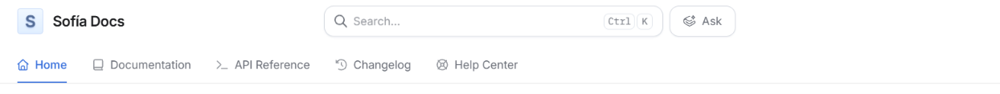
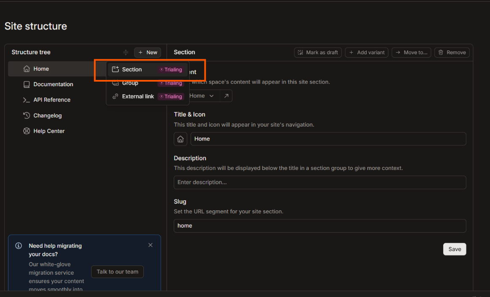
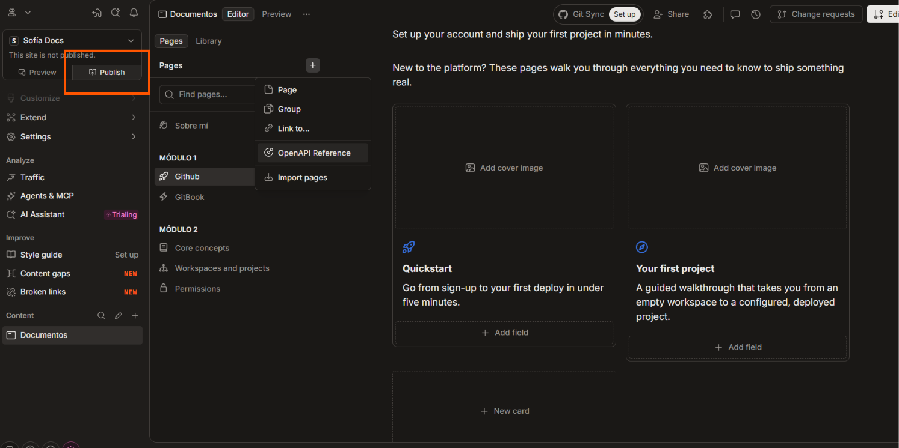
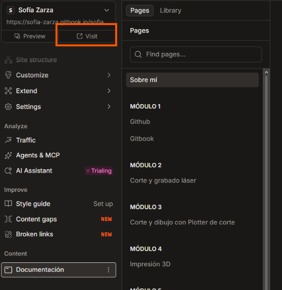
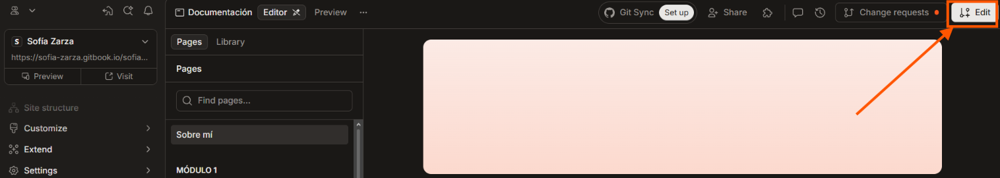

# Gitbook

Esta plataforma es, _según mí opinión_, menos compleja que la anterior, puede ser porque es como la parte estética de la web.

## Cómo crear una cuenta

Para iniciar, tenemos que tener ya lista nuestra cuenta en Github para ingresar con esa cuenta.

Al ingresar, te pide ingresar a una organización o crearla, _tranquil@, no es crear una empresa_, simplemente tu espacio de trabajo.

Al crear tu organización puedes ponerle un nombre fácil como "documentos de _tu nombre_" y luego le das en crear organización. A continuación verás las imágenes de todos los pasos que debes realizar para entrar a la app y empezar a crear tu sitio.



<figure><figcaption>
Primero le pones un nombre a tu organización y das click a continuar.
</figcaption></figure>

<figure><figcaption>
Esta es la primera ventana de opciones, de cuatro, en la que debes elegir "<em>Start with our template</em>" y continuar.
</figcaption></figure>

<figure><figcaption>
Esta es la siguiente ventana en la que deberás dejarla pública para este ejercicio.
</figcaption></figure>

<figure><figcaption>
Y esta es la última en la que no seleccionaremos nada para luego crear nuestro documento y cuando cargue todo aparecerá una opción de "<em>Abrir la app</em>"
</figcaption></figure>

## Mi primer sitio

Al tener tu organización y automáticamente te abrirá dentro de tu primer sitio. Así que debes _scrolear_ hasta abajo las opciones de la columna izquierda hasta lo que tengas en "_Content_" que muy capaz tengas las opciones de "_Home, Documentation, API Reference, Changelog y Help Center_" estas las eliminarás todas para crear tu/s propia/s sección/ones.

<figure><figcaption>
Primera ventana al entrar a la app. Deberás encontrar esas opciones marcadas en el recuadro amarillo y ubicar el cursor sobre cualquiera de ellos para poder encontrar los 3 puntitos.
</figcaption></figure>

Luego de dar click a los 3 puntitos en "_home_" podrás acceder a la edición y a eliminar las secciones preestablecidas que veremos seguidamente.

<figure><figcaption>
Seleccionar "<em>Edit navegation item</em>"
</figcaption></figure>

La jerarquía va así: En una sección puedes hacer varios grupos con páginas, pero también puedes hacer solo páginas. Si haces 6 secciones (una para cada módulo) puedes hacer páginas para cada documentación.

### ¿Qué son las secciones?

En el sitio web se ven así, es decir, son como diferentes ventanas en un mismo sitio. Puedes hacer las secciones para separar los temas como está en la siguiente imagen.

<figure><figcaption></figcaption></figure>

### Grupos y páginas

Desde este paso ya es completamente personalizado. En mi caso solo quiero tener una sección y ahí realizar varios grupos, pero también puedes hacer una sección por módulo y poner varias páginas ahí. ¿Páginas, grupos? Bueno, te muestro qué son.

<figure><figcaption>
Estos son las Páginas y grupos
</figcaption></figure>

En mi caso en una sola sección quiero poner todo, entonces debo hacer en esa sección 6 grupos y en los grupos poner páginas para cada documentación y queda más o menos como en la figura de arriba.

### ¿Cómo editar lo pre-establecido?

Para cambiar lo pre-establecido por GitBook debes entrar a la edición de las secciones y luego eliminarlas todas para crear nuevas secciones. Y lo haremos así...

<figure><figcaption>
Ya una vez entrando a la edición de secciones...
</figcaption></figure>

Nuevamente pasamos el cursor por encima para que aparezcan otros 3 puntitos y "_remove_" para eliminarlos, luego de eliminarlos todos hacemos click en "_New_" y en _sección_

<figure><figcaption>
Al crear una nueva sección podemos elegir plantillas para las páginas
</figcaption></figure>

<figure><figcaption>
Estas son las plantillas, en mi caso seleccioné la de "<em>Product Docs</em>"
</figcaption></figure>

Luego de seleccionar la plantilla le damos un nombre y ya tenemos nuestra sección, en mi caso la llamé "_Documentación_".

<figure><figcaption>
Este será el nombre de tu sección, yo le llamé documentación, pero le puedes poner "pasantía" o el nombre de cada módulo si decides hacer una sección por módulo.
</figcaption></figure>

<figure><figcaption>
Antes de empezar a hacer los grupos y páginas debes desactivar esta opción de "<em>Draft</em>" 
</figcaption></figure>

Ahora para empezar a hacer los grupos y páginas tenemos que salir de la edición de secciones y para esto basta con darle click a la sección en la columna izquierda nuevamente.

<figure><figcaption>
Ventana de edición de grupos y páginas
</figcaption></figure>

Si intentas editar ahora no podrás, pero no porque hayas hecho algo mal sino porque nos falta un paso, debemos activar la edición en live.

<figure><figcaption>
En donde estan los 3 puntitos en la parte superior de la ventana podremos encontrar la opción de "<em>Unlock live edits</em>" al darle click ya podremos editarlos.
</figcaption></figure>

### ¿Cómo cambiar los títulos de las páginas?

Ahora debemos hacer lo mismo que hicimos con las secciónes. Eliminar los grupos que estén de más, o renombrarlos a necesidad y para esto al cambiar el título en la página ya cambia el título en la pestaña, pero para los grupos es diferente.

<figure><figcaption>
Cambio de título a la página
</figcaption></figure>

<figure><figcaption>
En los 3 puntitos del grupo tenemos la opción de editar su título, en mi caso le puse los respectivos módulos.
</figcaption></figure>

<figure><figcaption>
Para eliminar tanto un grupo como página puedes encontrar la opción en los 3 puntitos también.
</figcaption></figure>

Cuando ya tengas los grupos y las páginas que necesites puedes borrar todo el contenido predeterminado de las páginas ya que allí irá tu documentación (como lo que ahora mismo estás leyendo).

## ¿Cómo publico mi sitio web?

Luego de todo esto, estamos listos para publicarlo y luego seguir editando el contenido.

<figure><figcaption>
Opción de publicar en la ventana
</figcaption></figure>

Luego de publicar se deberá de ver "_Visit_" en lugar de "_Publish_"

<figure><figcaption>
Opción cuando ya está el sitio web publicado.
</figcaption></figure>

## ¿Cómo volver a editar?

Al tener esto así ya no podrás editar en live como lo hicimos anteriormente, sino deberás ingresar a las opciones que veremos a continuación.

<figure><figcaption>
Primero a la opción "<em>Edit</em>"
</figcaption></figure>

<figure><figcaption>
Luego "<em>Create change request</em>".
</figcaption></figure>

Al hacer esto ya puedes editarlo, pero cuidado, si sales de la pestaña del navegador podrás perder todo tu avance, para esto debes realizar los siguientes pasos.

<figure><figcaption>
Click a la opción "<em>Ready to merge</em>"
</figcaption></figure>

<figure><figcaption>
Y click a "<em>Merge changes</em>", si no realizas esto podrás perder todo lo que avanzaste luego de publicar.
</figcaption></figure>

Al guardar ya podrás salir con tranquilidad y ver tu sitio web publicado con los cambios realizados.

## Mi Gitbook

Así pude hacer el sitio web en GitBook para la documentación de pasantía son varios pasos pero una vez que le entendes ya es sencillo.



## Preguntas, problemas y soluciones

¿Por qué no puedo editar mi sitio con live edit?

Puede que tengas tu cuenta sincronizada con GitHub y en ese caso debes editarlo como si ya lo hubieras publicado. [Click aquí](gitbook.md#como-volver-a-editar)

Puede que ya se haya publicado tu página. De todas formas, es el mismo modo de edición que el caso de sincronización.

¿Cómo hago carpetas para tener una breve introducción a cada módulo?

Para esto debes arrastrar una <mark style="color:$primary;">página</mark> sobre otra y así esa <mark style="color:$primary;">página</mark> quedará bajo la primera con una flechita y puedes usar la <mark style="color:$warning;">página principal</mark> como introducción del módulo y las <mark style="color:$primary;">páginas</mark> bajo esta para el contenido del módulo.

¿Qué más puedo personalizar en mi GitBook?

Puedes editar la tipografía, el color de la letra y página. Puedes agregar títulos 1, 2, 3 y 4 además de agregar links, información, columnas, cuadros o pestañas expandibles como esta.

¿Cómo puedo cargar mi video?

La presentación directa en la página solo está disponible para imagenes o gif, pero en el caso de videos deberás cargarlos como links de youtube o como videos sin links pero en ese caso no tendrá una vista previa y se reproducirá en otra ventana.

¿Qué pasa si se descentra la imagen del texto?

A mí me pasó que mi texto tenia un margen diferente al de las imágenes y era porque tenía una configuración puesta para esto.

<figure><figcaption></figcaption></figure>

Y para resolver esto, solo desactivé la opción "wide" en "page options" de esta manera:

<figure><figcaption></figcaption></figure>

¿Cómo hago para dar a los usuarios la posibilidad de alternar de modo claro/oscuro?

Al entrar a mi sitio web me di cuenta que quería alternar al modo claro siendo que tengo mi computadora en modo oscuro, entonces decidí habilitar a los usuarios a que puedan cambiar ellos también si gustan, para esto debí hacer lo siguiente.

<figure><figcaption>
Selecionar la opción "Show mode toggle" que se encuentra dentro de "Customize" en "Theme" en la columna izquierda.
</figcaption></figure>

¿Cómo cambio la imagen de mi cover?

Debemos pasar el cursor sobre el cover hasta que aparezca "cover options" y en eso seleccionar "Change image" y de ahí es necesario que pongas "Set cover applied on both" si tienes un solo cover, pero si tienes para ambos modos de visualización puedes configurarlos también por separado.

<figure><figcaption></figcaption></figure>

***


¡Ve la siguiente documentación dando click a la flecha de la derecha!

