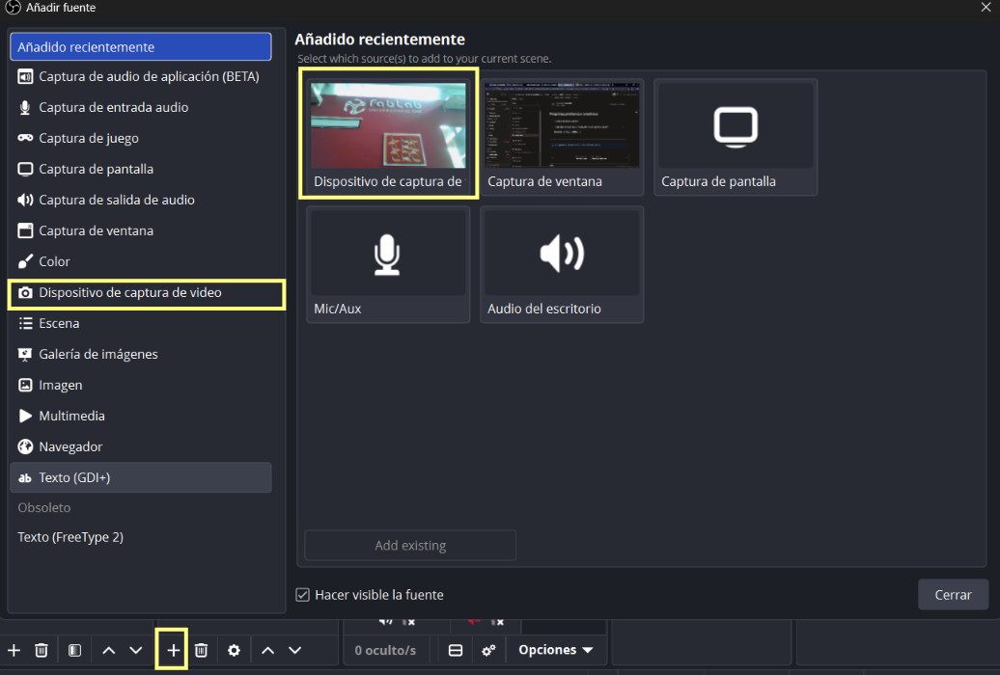
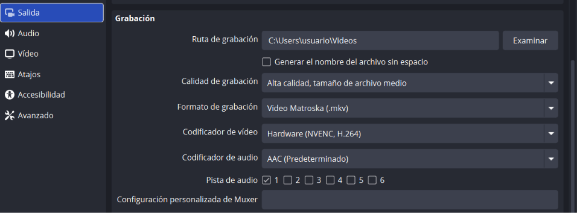

# Usando OBS

OBS es un software de grabación y transmisión de pantalla. Es bastante utilizada en la industria del streaming y aparte de ser gratuita es bastante completa e incluso tiene actualizaciones constantes. Este programa también puede grabar con cámaras y audio externo a la computadora, pero para este ejercicio haremos una grabación básica.



## ¿Cómo es el inicio del programa?

Luego de descargar el software, al abrir esta será tu página inicial.

<figure><figcaption></figcaption></figure>

Existen varias pestañas para configurar antes de poder gabar o iniciar una transmisión.

## ¿Cómo grabo solo una ventana?

En la pestaña de "Fuentes" se puede programar si deseas grabar captura de pantalla o "captura de ventana" que es la opción que seleccionaremos. Ahí puedes ver las opciones de las ventas que tienes abiertas y seleccionar la que más desees.

<figure><figcaption>
Aquí seleccionas la ventana que quieras grabar.
</figcaption></figure>

En mi caso para este ejercicio gabaré solo una ventana, que sería la ubicación de maps del CIDi.

## ¿Cómo activar o desactivar el audio?

Otra opción de conficuración es el mezclador de audio, en el cual tienes la opción de grabar con audio de la pantalla y otra del audio de microfono de la computadora.

<figure><figcaption>
En mi caso tengo el "Mic/Aux" desactivado para que no se escuche el exterior de la computadora.
</figcaption></figure>

## ¿Cómo empiezo a grabar?

Y por último está la opción de controles, estos son los que te ayudarán a inicar tu grabación. Al dar click a "Iniciar Grabación" ya estará grabandose.

<figure><figcaption>
Opciones tanto para iniciar transmisión y grabación.
</figcaption></figure>

Así se debería de ver tu pantalla en el caso que quieras grabar solo una ventana.

<figure><figcaption>
Las ventanas pueden ser tanto del buscador o de una app. En el caso de esta imagen es GIMP
</figcaption></figure>

## ¿Dónde se guardan mis grabaciones?

Al finalizar las grabaciones son guardadas en la carpeta de video de tu dispositivo.

<figure><figcaption>
Se guardan con el formato año-mes-día hora-minuto-segundo de la finalización de la grabación.
</figcaption></figure>

Y así de fácil grabas la pantalla de tu dispositivo.

## Prueba de OBS

En mi caso grabé la ubicación del CIDi



## Preguntas, problemas y soluciones

¿Por qué se me corta la grabación?

En mi caso intenté una prueba de grabación de la forma de editar con GIMP pero se cortó la grabación en medio de la nada y era porque en los atajos estaba "ctrl+C" como detener grabación. Por lo que debes atender qué atajos tienes configurados.

Para esto entra en Archivo>Ajustes>Atajos y debes configurar lo que te parezca más fácil, en mi caso configuré para inicio y final de grabación "ctrl+X" y para detener o reanudar grabación puse "ctrl+A"

¿Puedo grabar con la cámara de mi computadora y poner como video-reacción?

Sí, puedes configurar estableciendo una nueva fuente y entrando en ajustes para establecer la cámara como una fuente. También durante la grabación puedes apagar o prender esta fuente e incluso cambiar la grabación de ventana a pantalla o viceversa.

<figure><figcaption></figcaption></figure>

¿Puedo cambiar el lugar donde se guardan los videos?

Sí se puede, en Archivo>Ajustes>Salida en el apartado de grabación, peudes cambiar la ruta de grabación a la carpeta que desees, pero el nombre con el que se guarden los videos será el mismo siempre.

<figure><figcaption></figcaption></figure>

***


¡Ve la siguiente documentación dando click a la flecha de la derecha!

